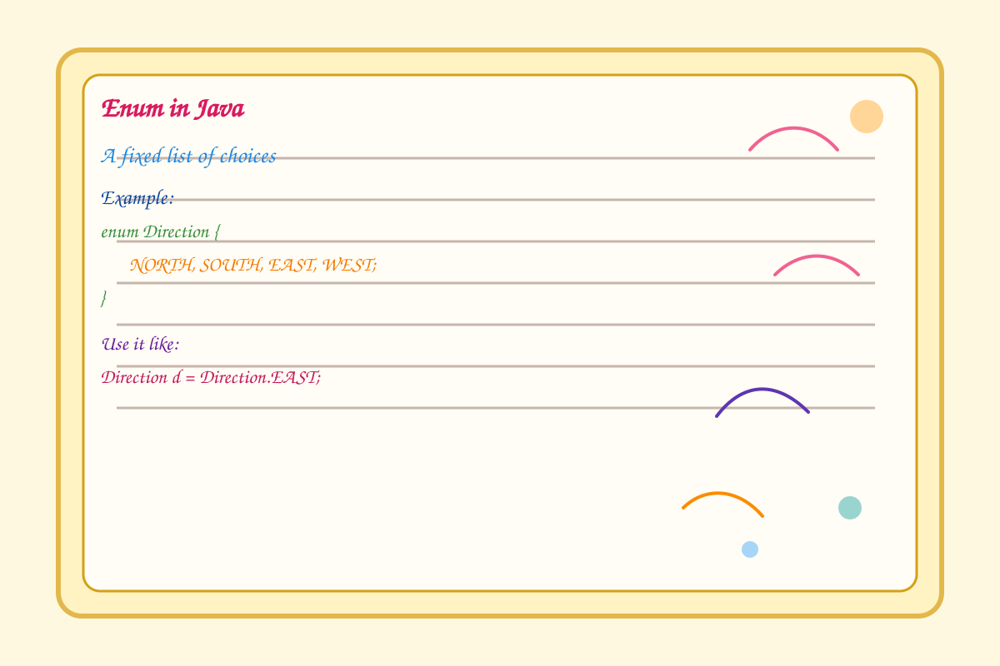

# Enum in Java

This note demonstrates how enums work in Java using the example from Demo5.



## What is an enum?

An enum is a special Java type used to define a fixed set of constants.

```java
enum Direction {
    NORTH,
    SOUTH,
    EAST,
    WEST;
}
```

## Example

```java
public class Demo5 {
    public static void main(String[] args) {
        Direction d = Direction.valueOf("EAST");
        System.out.println(d);
        System.out.println(d.ordinal());
    }
}
```

## Useful enum methods

- values() -> iterate through all enum constants
- valueOf("NAME") -> convert a string into an enum constant
- name() -> returns the exact enum name
- toString() -> returns a custom string representation
- ordinal() -> returns the position of the constant

## Quick idea

Think of an enum as a neat list of fixed choices such as:

- directions
- days of the week
- payment statuses

You can run the example from Demo5 in your Java workspace to see it in action.
